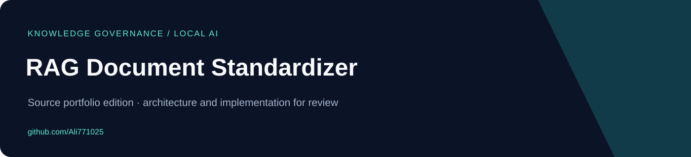

# RAG Document Standardizer

**Persian SQL/Markdown knowledge-base standardization with deterministic validation, optional local LLM enrichment, and human approval.**

[فارسی](docs/README.fa.md) · [Architecture](docs/ARCHITECTURE.md) · [Publication scope](docs/PUBLIC_EDITION.md)

## What the source contains

- SQL/Markdown parsing, source-grounded validation and quality/conflict checks.
- Optional local-model suggestions constrained by deterministic evidence checks.
- Draft outputs, a SQLite-backed review queue, CLI and a small FastAPI web interface.

## Start exploring

Python 3.11+; Ollama and a compatible local model only when LLM enrichment is enabled.

```bash
python -m pip install -e .
rag-standardizer --help
rag-standardizer standardize --input ./input --output ./output --no-llm
```

These commands are a setup reference, not a record of successful execution. No builds, tests, hardware sessions, provider requests or application runs were performed for this publication.

## Code entry points

- [`standardizer/engine.py`](standardizer/engine.py)
- [`standardizer/validators.py`](standardizer/validators.py)
- [`standardizer/api.py`](standardizer/api.py)
- [`standardizer/cli.py`](standardizer/cli.py)

## Architecture


See the [architecture guide](docs/ARCHITECTURE.md) for module boundaries and integration assumptions. Diagrams represent source structure; they are not screenshots or deployment evidence.

## Scope and current limits

Original organization-specific SQL examples and knowledge documents are excluded. Supply your own non-sensitive inputs. The approval workflow and validators are represented in source; no new evaluation or accuracy claim is made. Review approval is a separate human decision, not something delegated to the model.

This compact public edition excludes previous Git history, real environment files, customer material, generated outputs and installed dependencies. Existing source/license notices are retained where present; no additional application license grant is invented.

## Work together

For a related workflow, custom application, integration or modernization project, [visit my GitHub profile](https://github.com/Ali771025) or [describe your project in an issue](https://github.com/Ali771025/rag-document-standardizer/issues/new). Scope and deployment requirements can be discussed before implementation.
