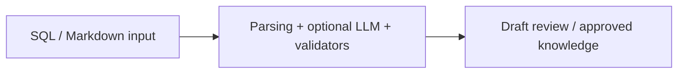

# Architecture — RAG Document Standardizer

[Back to the project](../README.md)

## Responsibilities

- **SQL / Markdown input:** SQL/Markdown parsing, source-grounded validation and quality/conflict checks.
- **Parsing + optional LLM + validators:** Optional local-model suggestions constrained by deterministic evidence checks.
- **Draft review / approved knowledge:** Draft outputs, a SQLite-backed review queue, CLI and a small FastAPI web interface.

## Source boundaries

Original organization-specific SQL examples and knowledge documents are excluded. Supply your own non-sensitive inputs. The approval workflow and validators are represented in source; no new evaluation or accuracy claim is made. Review approval is a separate human decision, not something delegated to the model.

## Review entry points

- [`standardizer/engine.py`](../standardizer/engine.py)
- [`standardizer/validators.py`](../standardizer/validators.py)
- [`standardizer/api.py`](../standardizer/api.py)
- [`standardizer/cli.py`](../standardizer/cli.py)

## Verification boundary

This document is based on a static reading of the source. No new tests or builds were performed. Integration prerequisites, permission behavior, external dependencies and real data quality require their own acceptance work before production use.
