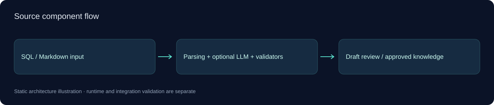

# استانداردسازی اسناد و دانش برای RAG

<!-- project-contact:start -->
**درخواست پروژه و همکاری با یوسف عمرانی:** [ارسال ایمیل](mailto:aliomrani916@gmail.com) · **aliomrani916@gmail.com** · [خدمات و تماس](https://ali771025.github.io/software-portfolio/contact/) · [معرفی نمونه‌کار](https://ali771025.github.io/software-portfolio/#projects)
<!-- project-contact:end -->

[معرفی و ساختار کد](../README.md) · [معماری](ARCHITECTURE.md)

این مخزن نسخه کم‌حجم سورس برای بررسی نمونه‌کار و گفت‌وگو درباره همکاری است. معرفی دقیق قابلیت‌های موجود در کد و پیش‌نیازهای اجرا در صفحه اصلی آمده است؛ سطح بلوغ هر پروژه باید از بخش محدودیت‌ها خوانده شود.

## محدوده انتشار

قراردادها، تنظیمات خصوصی، داده‌های واقعی، مدل‌های حجیم، بسته‌های نصب‌شده و خروجی‌های اجرایی منتشر نشده‌اند. هیچ تست، ساخت یا ارزیابی عملیاتی تازه‌ای برای این انتشار اجرا نشده است. نمودارها نمایش ساختار کد هستند و نتیجه اجرای واقعی یا صحت اندازه‌گیری را نشان نمی‌دهند.

## همکاری

برای طراحی یا توسعه قابلیت‌های مشابه، اتصال سرویس‌ها یا بازطراحی بخش‌های قدیمی، از طریق [پروفایل GitHub](https://github.com/Ali771025) یا [ثبت درخواست پروژه](https://github.com/Ali771025/rag-document-standardizer/issues/new) ارتباط بگیرید. درباره دامنه کار، پیش‌نیازها و مجوز استفاده از کد به‌صورت مشخص توافق می‌شود.
